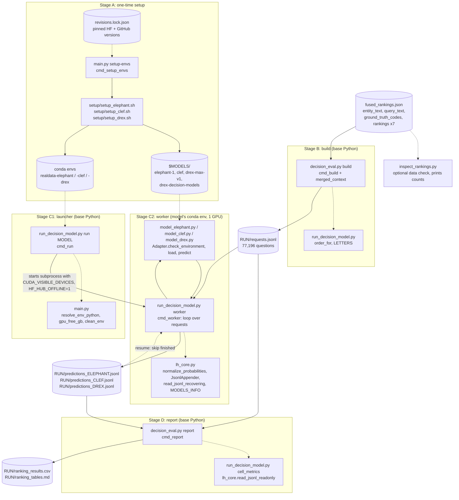

# How the RealData code works

This explains the code, from the big picture down to individual functions. For the commands to run, see [README.md](README.md).

Most of the lines in this folder are **not used** by the real-data run. `main.py` (1,026 lines) and `lh_core.py` (541 lines) were copied from the LongHealth project, and this run calls only about a dozen of their functions. Section 2 says which ones.

---

## 1. Level 0: the whole pipeline

```
fused_rankings.json                     (your data: one object per entity)
        │
        │  decision_eval.py build       (base Python, CPU, seconds)
        ▼
RUN/requests.jsonl                      (one line per question we will ask a model)
        │
        │  run_decision_model.py run MODEL   (base Python launches a worker in the model's conda env, on 1 GPU)
        ▼
RUN/predictions_ELEPHANT.jsonl          (one line per answered question, written as it goes)
RUN/predictions_CLEF.jsonl
RUN/predictions_DREX.jsonl
        │
        │  decision_eval.py report      (base Python, CPU, seconds)
        ▼
RUN/ranking_results.csv + RUN/ranking_tables.md
```

### How the files connect

Solid arrows show data moving from one step to the next. Dotted arrows show "calls functions from" or "reads". Cylinders are files on disk; boxes are code.



The worker box runs once per model, and you start each run yourself. All three write to the same `RUN` folder, each to its own predictions file. The report reads whichever predictions files exist.

What happens, in one paragraph: for each entity, `build` takes the top-k codes from one ranking source and turns them into a multiple-choice question. The options are lettered A, B, C, and so on, and each option is a bare code. Each model returns a probability for every letter. The highest probability is the model's answer. `report` compares that answer with the ground-truth code and summarises the results per source, k, option order and model.

How many questions per model: 1,838 entities × 7 sources × 3 values of k (5, 10, 20) × 2 option orders (original, shuf1) = **77,196**.

---

## 2. Level 1: the files

**Files you call directly**

- [decision_eval.py](decision_eval.py) (107 lines): real-data specific. It has `build` (data → requests) and `report` (predictions → tables). This is the only file written for the real-data format.
- [run_decision_model.py](run_decision_model.py) (353 lines): the model runner. RealData uses only its `run` and `worker` commands, plus three helpers that `decision_eval.py` imports (`LETTERS`, `order_for`, `cell_metrics`). Its own `build` and `report` commands are for the synthetic ClinicalRag file format and **do not work on fused_rankings.json**.
- [inspect_rankings.py](inspect_rankings.py) (42 lines): a standalone data check that prints counts only. It doesn't import anything from this folder.
- [main.py](main.py): used only for `setup-envs`, the one-time install. The runner also borrows three small helpers from it.

**Files that run inside each model's conda env**

- [model_elephant.py](model_elephant.py), [model_clef.py](model_clef.py), [model_drex.py](model_drex.py): one *adapter* per model. Each turns our request into that model's native call and returns `{letter: probability}`.

**Supporting files**

- [lh_core.py](lh_core.py): the model table (`MODELS_INFO`), plus safe file reading and writing and probability checks. It uses the standard library only, because both the base Python and the three model envs import it.
- [revisions.lock.json](revisions.lock.json): exact Hugging Face and GitHub versions. `setup-envs` reads it.
- [setup/setup_*.sh](setup/): one install script per model. Each creates the conda env, installs packages and downloads the weights, or, with `--hf-cache`, verifies and links them from a shared cache ([setup/shared_cache.py](setup/shared_cache.py), [setup/checkpoint_files.json](setup/checkpoint_files.json)).

**Not used by the real-data run:** in `main.py`, everything about LongHealth (frozen examples, `run`, `compare`, figures, bootstrap). In `lh_core.py`, `run_job`, the gates, `RunLock`, `worker_main` and `load_frozen`. In `run_decision_model.py`, `build_requests`, `diagnostics`, `cmd_build`, `cmd_report`, `comparison_tables` and `auroc`.

---

## 3. Level 2: each stage step by step

### Stage A: setup (once): `main.py --project-dir $MODELS setup-envs`

[cmd_setup_envs](main.py#L139) does the following for each model in turn:

1. Reads the pinned revisions from `revisions.lock.json` ([load_lock](main.py#L78)).
2. Runs `bash setup/setup_<model>.sh $MODELS` with `CHECKPOINT_REVISION` set, and for Drex also `RUNTIME_REVISION`.
3. The script creates the conda env (`realdata-elephant`, `realdata-clef` or `realdata-drex`; names from `MODELS_INFO`, passed as `ENV_NAME`), installs pinned torch and transformers, and downloads the weights into `$MODELS/<weights_dir>`:
   - **Elephant-1:** `hf download baselabs/elephant-1` → `$MODELS/elephant-1`. It then runs the checkpoint's own `setup.sh`, which clones OneJev, applies `serve.patch` and installs the `qev` package.
   - **Clef:** `hf download Cloudflare/clef` → `$MODELS/clef`. Its Python code (`joint_schema_model.py`) is inside that download.
   - **Drex Max:** `git clone drex-decision-models` → `$MODELS/drex-decision-models` (checked out at the pinned commit), then `hf download nace-ai/drex-max-v1` → `$MODELS/drex-max-v1`.
4. It stops at the first failing model and saves `pip freeze` output to `$MODELS/setup_logs/`.

With `--hf-cache DIR` (a shared Hugging Face hub cache), step 3 does not download. `get_checkpoint` in
[setup/checkpoint.sh](setup/checkpoint.sh) calls `setup/shared_cache.py link` instead. That looks in
`DIR/models--ORG--NAME/snapshots/`, trying the pinned commit first. It accepts a snapshot whose required files (all except
README, LICENSE, images and `.eval_results`) match `setup/checkpoint_files.json` in size and hash. Cache files are symlinks
to blobs named by their hash, so no weights are read. It then makes `$MODELS/<weights_dir>` a symlink to that snapshot and
writes `$MODELS/setup_logs/<weights_dir>_source.json`. The workers are unchanged because they still read
`$MODELS/<weights_dir>`. `checkpoint_files.json` is generated from the Hub API by `python setup/shared_cache.py manifest`
for the revisions in the lock file.

After this, `$MODELS` is the folder you pass as `--weights-dir` in every run.

### Stage B: build requests: `decision_eval.py build --src fused_rankings.json --run-dir $RUN`

[cmd_build](decision_eval.py#L73) first checks the whole file with [validate](decision_eval.py#L34): unique non-empty `entity_id`
(no `|`), non-empty `entity_text`, exactly one ground-truth code, all 7 sources with 20 unique string codes. Any problem stops the
build with the entity ids and nothing is written. Then it uses five nested loops:

```
for each entity d in the file:
    state = merged_context(entity_text, query_text)        (the context the model reads)
    for source in the 7 SOURCES:
        for k in 5, 10, 20:
            for order in original, shuf1:
                top   = rankings[source][:k]
                codes = order_for(top, order, ...)          (same list, maybe shuffled)
                write one request line
```

- **The context** ([merged_context](decision_eval.py#L29)): if the query text equals the entity text (ignoring case and spaces), the context is just the entity text. Otherwise it is `entity (expanded: query)`, for example `CHF (expanded: congestive heart failure)`.
- **The question** is always the same: `Which ICD-10-CA code best matches the diagnosis described above?` ([QUESTION](decision_eval.py#L26)).
- **The options** are bare codes, lettered A to T in the order of `codes`.
- **Original order** keeps the retriever's ranking, so A is rank 1. **shuf1** is a fixed random order. The shuffle seed is a hash of `entity_id|source|k|shuf1`, so rebuilding gives the same order and all three models see identical questions.
- It prints recall per source and k, and stops if no reference code appears in any top-20 list (a code-format mismatch).
- It writes `requests.jsonl.tmp` and renames it at the end, so a failed build never leaves a partial file.
- It refuses a run folder that already has `requests.jsonl` or any predictions, so an old run is never overwritten or mixed.

### Stage C: run one model: `run_decision_model.py run MODEL --gpu N --run-dir $RUN --weights-dir $MODELS`

This uses **two processes**, because each model needs its own Python and package versions.

**1. Launcher** ([cmd_run](run_decision_model.py#L200)), in your base Python:
- Finds the model env's Python with [resolve_env_python](main.py#L117), which runs `conda env list`.
- Checks free memory on that GPU with [gpu_free_gb](main.py#L371) (`nvidia-smi`), and stops if it is below `min_vram_gb`: 22 GB for Elephant-1, 60 GB for Clef, 58 GB for Drex.
- Starts the worker with a clean environment ([clean_env](main.py#L133)):
  - `CUDA_VISIBLE_DEVICES=N`: the worker sees only that GPU, as `cuda:0`.
  - `HF_HUB_OFFLINE=1`: nothing is downloaded; weights load from disk.
  - `PYTHONNOUSERSITE=1`: no packages from `~/.local` leak in.
- Turns `--weights-dir` into an absolute path (the worker starts in the RealData folder) and checks that `requests.jsonl` exists.
- Exits with the worker's exit code.

**2. Worker** ([cmd_worker](run_decision_model.py#L127)), in the model's conda env:
1. Takes a lock on `predictions_<MODEL>.jsonl.lock`, so a second worker for the same model and run folder stops at once. It
   records the sha256 of `requests.jsonl` in `predictions_<MODEL>.jsonl.meta.json` and refuses to resume if it has changed
   (or if a predictions file has no meta file).
2. Loads `model_<name>.py` and creates its `Adapter`. It points the adapter at `--weights-dir`, so weights are read from `$MODELS/<weights_dir>`.
3. `adapter.check_environment()`: confirms the right torch and transformers versions, CUDA, and that the weights exist. A mismatch stops the worker before any work.
4. `adapter.load()`: loads the model onto the GPU.
5. Reads `requests.jsonl`. With `--stride S` it keeps about 1 in S requests, chosen by a hash of the request id (so every order, source and k is sampled), and writes to `predictions_<MODEL>_smoke.jsonl` instead.
6. **Resume:** reads any existing predictions file and skips requests that already have `status: ok`. Errored requests are tried again.
7. For each remaining request, one at a time (no batching):
   - `adapter.predict(record)` returns `{letter: probability}`.
   - [normalize_probabilities](lh_core.py#L63) checks that the letters match the options exactly, every value is finite and non-negative, and the values sum to between 0.98 and 1.02. It then rescales them to sum to exactly 1.
   - The answer is the letter with the highest probability, mapped back to its code.
   - One line is appended to the predictions file and fsynced at once ([JsonlAppender](lh_core.py#L159)), so a crash loses at most one row.
   - On an exception, the worker writes a `status: error` line with the error type, then frees GPU memory.
   - After **5 errors in a row** the worker stops (exit 3).
8. Logs progress and the estimated time left every 200 requests.
9. Ends with `finished, N/N ok`, or with how many requests have no result and why (rerunning retries them).

### Stage D: report: `decision_eval.py report --run-dir $RUN`

[cmd_report](decision_eval.py#L116) does the following:

1. Loads all requests, and the `status: ok` rows of each `predictions_<MODEL>.jsonl` that exists. Smoke files are ignored.
2. Groups requests by **(source, k, order)**, which gives 7 × 3 × 2 = 42 groups.
3. For each group and each model, it computes the metrics in section 5. Most come from [cell_metrics](run_decision_model.py#L240).
4. It adds two model-free columns per group:
   - **Recall:** the share of requests where the ground-truth code is in the top-k at all.
   - **Always rank 1:** the accuracy you would get by always picking the retriever's first code.
5. Writes `ranking_results.csv` (all numbers) and `ranking_tables.md` (one table per option order). A model with missing answers in a group is marked `INCOMPLETE n/expected`.

It only reads files and never changes them, so it is safe to run while a model is still running. The numbers are then partial and flagged.

---

## 4. Data at each step

**Input**: one object from `fused_rankings.json`, showing the keys used. The values here are invented:

```json
{"entity_id": "e17", "note_id": "n4", "entity_text": "CHF", "query_text": "congestive heart failure",
 "ground_truth_codes": ["I500"],
 "rankings": {"csv_dense": ["I500", "I110", "I509", ...], "snomed_fsn": [...], ... 7 sources}}
```

`start`, `end` and `note_id` are not used for the questions.

**`requests.jsonl`**: one line per question:

```json
{"request_id": "e17|csv_dense|top_5|shuf1", "entity_id": "e17", "source": "csv_dense", "k": 5, "order": "shuf1",
 "gt_code": "I500", "answerable": true, "gt_letter": "C", "rank1_correct": true,
 "codes": ["I509", "I110", "I500", "I420", "I119"],
 "record": {"state": "CHF (expanded: congestive heart failure)",
            "questions": {"longhealth": {"type": "choice",
                          "instructions": "Which ICD-10-CA code best matches the diagnosis described above?",
                          "criteria": {"A": "I509", "B": "I110", "C": "I500", "D": "I420", "E": "I119"}}}}}
```

- `record` is exactly what the model receives. Everything else is bookkeeping for the report.
- `answerable` means the ground-truth code is in these k codes. `rank1_correct` means the retriever's own first code is the ground truth.
- The key `"longhealth"` is only the question's name, kept from the LongHealth code. It has no effect on the answer.

**`predictions_<MODEL>.jsonl`**: one line per attempt:

```json
{"request_id": "e17|csv_dense|top_5|shuf1", "model": "DREX", "status": "ok", "prediction_letter": "C",
 "prediction_code": "I500", "probabilities": {"A": 0.08, "B": 0.03, "C": 0.85, "D": 0.02, "E": 0.02}, "latency_s": 0.41}
```

A failed attempt has `"status": "error"`, `error_type` and `failure_class` (`overlong`, `oom` or `error`). It contains no input text.

---

## 5. The metrics (per source × k × order × model)

- **Acc overall:** correct answers divided by all requests in the group. A request whose ground truth is not in the list can never be right, so it counts as wrong.
- **Acc | present:** accuracy on answerable requests only. This measures the model's choice once the right code is available.
- **Brier:** computed on answerable requests. For each request it is the sum over all options of (probability − 1 if the option is correct, else 0)², averaged over requests. It runs from 0 (perfect) to 2. A 5-option Brier and a 20-option Brier are not on quite the same scale.
- **ECE:** computed on answerable requests. Requests are split into 10 bins by the model's top probability. In each bin, the gap between average confidence and actual accuracy is weighted by the bin's size, then the gaps are added up. 0 means perfectly calibrated.
- **Recall** and **Always rank 1:** properties of the retriever, the same for every model (see Stage D).

These formulas match the LongHealth report; we checked them against `main.py`'s versions and they agreed to within 1e-15.

---

## 6. Level 3: function reference

### [decision_eval.py](decision_eval.py)

- [KS, ORDERS, SOURCES, QUESTION](decision_eval.py#L22): the settings. Change k, orders, sources or question wording here.
- [merged_context(entity, query)](decision_eval.py#L29): builds the context string (Stage B).
- [validate(data)](decision_eval.py#L34): lists every problem in the input file (entity ids and codes only).
- [cmd_build(args)](decision_eval.py#L73): data → `requests.jsonl`, only if `validate` finds nothing.
- [cmd_report(args)](decision_eval.py#L116): predictions → csv and markdown tables. It skips a predictions file whose meta file names a different `requests.jsonl`.
- [CLI](decision_eval.py#L162): the `build --src --run-dir` and `report --run-dir` subcommands.

### [run_decision_model.py](run_decision_model.py) (the parts RealData uses)

- [LETTERS](run_decision_model.py#L34): `A` to `T`, which allows at most 20 options.
- [order_for(codes, order, entity_id, k)](run_decision_model.py#L38): returns the codes as-is, reversed, or seeded-shuffled.
- [load_requests(run_dir, stride)](run_decision_model.py#L121): reads `requests.jsonl`; with `stride` > 1 keeps about 1 in `stride` requests, chosen by a hash of the request id.
- [cmd_worker(args)](run_decision_model.py#L127): the loop inside the model env (Stage C, worker).
- [cmd_run(args)](run_decision_model.py#L200): the launcher in base Python (Stage C, launcher).
- [cell_metrics(items)](run_decision_model.py#L240): computes Acc overall, Acc, Brier and ECE for a list of (request, prediction) pairs.
- [main()](run_decision_model.py#L374): the CLI. `run` and `worker` require `--weights-dir $MODELS` (the folder given to `setup-envs` as `--project-dir`); there is no default.

### Adapters: [model_elephant.py](model_elephant.py), [model_clef.py](model_clef.py), [model_drex.py](model_drex.py)

Every adapter has the same four methods that the worker calls:

- `check_environment()`: version, CUDA and weights checks. A failure raises `EnvironmentMismatch`.
- `load()`: loads the model onto `cuda:0`.
- `predict(record)`: returns `{letter: probability}`.
- `cleanup_after_failure()`: frees GPU memory after an error.

What `predict` does for each model:

- **Elephant-1** ([predict](model_elephant.py#L45)): wraps the record in qev's `SystemOneRequest(state, questions)`, calls `DecisionEngine.decide`, and reads `answers["longhealth"]["probabilities"]`.
- **Clef** ([predict](model_clef.py#L40)): `encode_record` tokenizes the record and rejects inputs over 16,000 tokens. `collate_records` makes a batch of one, and the model's logits go through a softmax, giving one probability per option.
- **Drex Max** ([predict](model_drex.py#L50)): calls `DecisionModel.predict([{state, question}], batch_size=1)`, then `answer(...)` to map the outputs to `{letter: probability}`.

Each adapter also converts its model's own "input too long" error into `OverlongInput`. With short entity contexts this is not expected to happen.

### [lh_core.py](lh_core.py) (the parts RealData uses)

- [MODELS_INFO](lh_core.py#L28): for each model, the conda env name, adapter file, Hugging Face repo, weights folder name and minimum free VRAM.
- [exceptions](lh_core.py#L40): `OverlongInput`, `EnvironmentMismatch`.
- [log(msg)](lh_core.py#L56): prints a line with a timestamp.
- [normalize_probabilities(p, choices)](lh_core.py#L63): validates and rescales a model's output.
- [classify_failure(exc)](lh_core.py#L81): sorts an error into `overlong`, `oom` or `error`.
- [read_jsonl_readonly(path)](lh_core.py#L129): reads a JSONL file without changing it, ignoring a half-written last line. It returns `(rows, dropped_bytes)`. The report uses it.
- [read_jsonl_recovering(path)](lh_core.py#L149): like the above, but cuts the half-written line off the file. The worker uses it when resuming.
- [JsonlAppender](lh_core.py#L159): appends one row and fsyncs it.

### [main.py](main.py) (the parts RealData uses)

- [load_lock](main.py#L78), [find_conda](main.py#L111), [cmd_setup_envs](main.py#L139): Stage A.
- [resolve_env_python](main.py#L117), [clean_env](main.py#L133), [gpu_free_gb](main.py#L371): used by the launcher.
- `main.py` imports numpy and pandas only if they are installed; just its LongHealth commands (`build-frozen`, `compare`) use them, so RealData runs on a plain `python3`.

---

## 7. Resuming, failures and smoke tests

- **Resume:** rerun the same `run` command with the same `--run-dir`. Finished requests are skipped and errored ones are retried. A new experiment needs a **new** `--run-dir`, otherwise it will "resume" into the old results.
- **Interrupt:** killing the worker loses at most the row being written. The next run trims that half-written line.
- **Smoke test:** `--stride 400` runs about 190 requests and writes to `predictions_<MODEL>_smoke.jsonl`, which the report ignores. Delete the smoke file and its `.meta.json` to repeat a smoke test from scratch.
- **Exit codes:**
  - 0: finished.
  - 3: 5 errors in a row.
  - Non-zero with a message before any requests: environment or GPU-memory check failed.

---

## 8. Gotchas

- **Conda env not found:** `cmd_run` stops with "conda env realdata-<model> not found" and the `setup-envs` command to run. This means `setup-envs` didn't finish for that model.
- **`--weights-dir`:** required; a wrong folder stops the launcher, and a folder without a checkpoint makes `check_environment` say "not found at …".
- **NVIDIA driver:** Clef's and Drex's torch builds are CUDA 13.0 and 13.2, so the driver must be 580 or newer.
- **Clef's version check is strict:** `transformers` must be exactly 5.10.2. Drex needs exactly 5.17.0, plus `flash-linear-attention` installed.
- **One model at a time per GPU:** Clef and Drex each need about 60 GB free. You can run two models at once on two different GPUs, with a different `--gpu` for each.
- **Same order every rebuild:** shuffles are seeded from the request identity, not from time, so rebuilding gives the same requests.

---

## 9. Where to change things

- **Adding code descriptions to the options (planned):** in [cmd_build](decision_eval.py#L73), change `criteria = dict(zip(letters, codes))` so each value is `f"{code}: {description}"`. Use a new `--run-dir`. Nothing else needs to change: the worker reads codes from `codes`, not from the option text.
- **Different k, sources or orders:** edit `KS`, `SOURCES` or `ORDERS` at the top of [decision_eval.py](decision_eval.py#L21). k can't go above 20 (`LETTERS`). An order must be one that [order_for](run_decision_model.py#L38) knows: `original`, `reversed`, or any name starting with `shuf`. Each new shuffle name gives a different fixed shuffle.
- **Adding the clinical note as context:** change `state` in [cmd_build](decision_eval.py#L73) and the question wording. Notes can be long, so check token lengths against the 16,000-token limit.
- **New metrics:** add them to the `rows.append({...})` in [cmd_report](decision_eval.py#L116). All raw probabilities are in the predictions files, so you can compute new metrics without rerunning the models.
